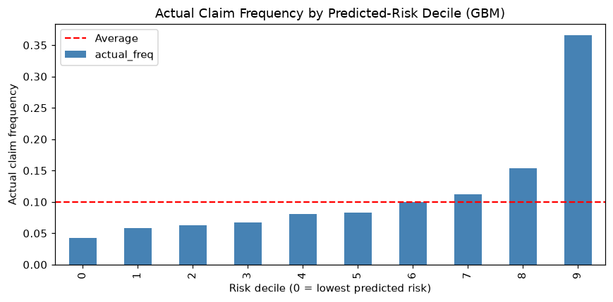
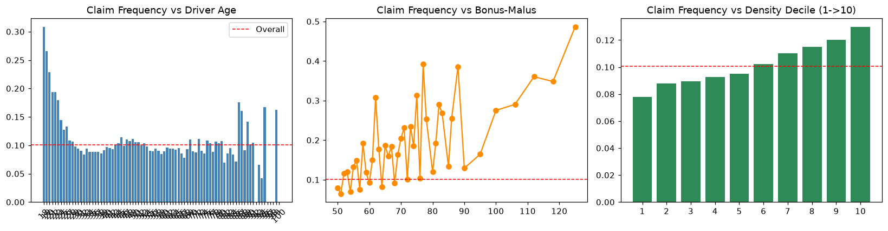
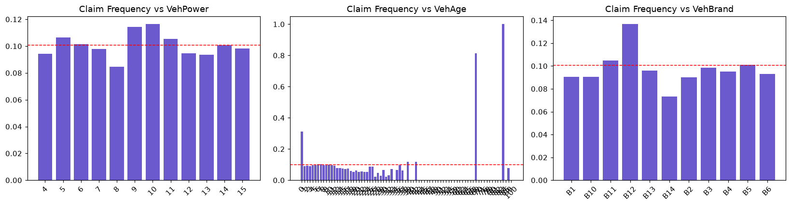

# 车险赔付预测与风险定价建模(French MTPL Dataset)

> **项目定位**:面向保险精算 / 风险管理方向的完整建模项目。基于 67 万张真实车险保单,走通保险行业标准的**赔付频率建模 → 风险分层 → 定价因子输出**全流程。
>
> **技术栈**:Python(pandas / scikit-learn / matplotlib)| Jupyter Notebook

## 业务背景

车险定价的核心是预测每张保单的赔付风险。精算中的标准做法是对**赔付频率(Claim Frequency = 赔付次数 / 暴露量)**建模,
再结合赔付强度得到纯保费:`纯保费 = 赔付频率 × 平均赔付强度`。本项目聚焦赔付频率环节:

1. 识别高风险客群(年轻驾驶员、高 Bonus-Malus、高密度地区等)
2. 建立可解释的费率因子(Relativities),直接服务于费率表
3. 用机器学习模型提升风险区分度,服务于核保筛选与续保风险评分

## 数据

- **来源**:OpenML `freMTPL2freq`(法国机动车第三者责任险,CASdatasets 教学数据集,广泛用于精算定价研究)
- **规模**:678,013 张保单,358,558 保单年暴露,36,056 次赔付
- **整体赔付频率**:0.1006 次 / 保单年
- **字段**:赔付次数(ClaimNb)、暴露量(Exposure)、地区(Area/Region)、车型功率/车龄/品牌/燃料(VehPower/VehAge/VehBrand/VehGas)、驾龄(DrivAge)、无赔款优待系数(BonusMalus)、地区密度(Density)

## 方法

建模目标 = 单位暴露赔付频率,以 Exposure 作为 Poisson 似然权重(数学上等价于 log(Exposure) 作 offset 的 Poisson 回归):

| 步骤 | 内容 |
|---|---|
| 数据质量 | 异常暴露截断(<0.02 年)、异常出险次数截断(>4 次) |
| EDA | 赔付频率随驾龄 / 车龄 / 品牌 / 地区密度 / Bonus-Malus 的分布 |
| 特征工程 | One-Hot(drop 参考水平)+ 连续变量标准化;训练/验证/测试 = 56%/14%/30% |
| 基线 | 全局平均赔付频率 |
| Poisson GLM | 对数链接,正则强度 alpha 在验证集上从 {1e-4 ... 1} 网格选择(选定 0.001) |
| GBM | HistGradientBoostingRegressor,Poisson Loss,捕捉非线性与特征交互 |

## 结果(测试集,样本外)

| 模型 | Poisson Deviance | 相对基线改善 | Gini(风险区分度) |
|---|---|---|---|
| 基线(全局平均频率) | 0.6209 | - | - |
| Poisson GLM | 0.6015 | 3.1% | 0.24 |
| GBM(Poisson Loss) | **0.5712** | **8.0%** | **0.33** |

**风险分层(GBM,按预测风险十分位)**:

| 风险十分位 | 实际赔付频率 | 预测赔付频率 | 相对平均提升度 |
|---|---|---|---|
| 最低 10% | 0.042 | 0.042 | 0.42× |
| 中间 | 0.083 | 0.086 | 0.83× |
| 最高 10% | 0.365 | 0.363 | **3.64×** |

预测值与实际值在各十分位高度吻合（校准良好），最高风险组的实际赔付频率约为平均的 3.6 倍 → 可直接支撑差异化定价 / 核保收紧策略。



**Poisson GLM 相对费率因子(Relativities)**:
- 类别因子:VehPower_9 = 1.22、VehBrand_B12 = 1.19、Area_E = 1.18(高风险);Region_R41 = 0.85(低风险)
- 连续因子(每 1 个标准差的费率比):BonusMalus = 1.42(最强风险因子)、DrivAge = 1.10、Density = 1.03、VehAge = 0.80
- `exp(β)` 即费率表中的相对费率因子:`纯保费 = 基准频率 × ∏ relativity × 平均赔付强度`

## 关键结论

1. **GLM 与 GBM 的可解释性 / 精度权衡**:GLM 输出监管可用的费率因子,GBM 预测精度更高(deviance 再降 5%、Gini 0.33),适合用于核保筛选与续保评分
2. Bonus-Malus 系数是单因子中最强的风险信号；GLM 的线性驾龄项无法刻画“年轻 + 高龄”的 U 型风险，GBM 可捕捉该非线性




3. 后续方向:赔付强度(Gamma/Tweedie)建模 → 纯保费一步建模、时间外推稳定性检验、SHAP 特征归因

## 项目结构

```
insurance-claims-prediction/
├── notebooks/
│   └── claims_prediction.ipynb   # 完整建模流程(已执行,含全部输出)
├── figures/
│   ├── eda_frequency.png         # EDA:频率 vs 驾龄/Bonus-Malus/地区密度
│   ├── eda_vehicle.png           # EDA:频率 vs 功率/车龄/品牌
│   └── lift_curve.png            # 风险十分位区分度图
├── requirements.txt
└── README.md
```

## 复现方式

```bash
pip install -r requirements.txt
jupyter notebook notebooks/claims_prediction.ipynb
# 数据首次运行自动从 OpenML 下载(离线环境自动回退到镜像 CSV)
```

## 面试可讲的三个点

1. **口径**:为什么用"频率 = 次数/暴露 + Exposure 加权"而不是直接回归赔付次数?(答:等价于 offset 模型,消除保单在保时长差异)
2. **评估**:为什么用 Poisson Deviance 而不是 MSE?(答:计数数据、异方差、与 GLM 似然一致);Gini / Lift 怎么解释业务价值?
3. **落地**:GLM 系数怎么进费率表?高/低风险客群的核保和定价动作分别是什么?
